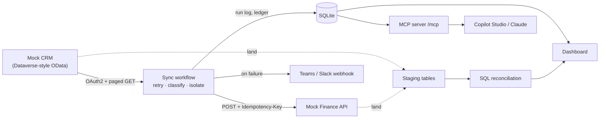

# SyncWatch

**An integration that moves won deals from a Dynamics-style CRM into a finance
system as invoices. It handles failures properly, explains errors in plain
English, and proves with SQL that the numbers match.**

> Live demo: **https://syncwatch.onrender.com** · API docs: `/docs` · MCP endpoint: `/mcp/`
> (Free hosting, so the first request after an idle period takes ~30s to wake up.)


---

## The problem

Sales close deals in the CRM. Finance needs an invoice for each one. In real life:

- some deals are closed with no amount or currency filled in
- some customer accounts have no billing email, so Finance rejects them
- the CRM throttles you, tokens expire, and the finance API has outages
- somebody renames a column
- a deal gets edited *after* it was invoiced

Most integrations either crash on the first bad record or skip it silently.
SyncWatch does neither. It keeps going, tags every failure with a category that
says **what happened, who has to fix it, and whether a retry will help**, and
gives you a reconciliation page that shows whether the totals agree.

## What's in it

| | |
|---|---|
| **Mock CRM** (`/mock/crm`) | Dataverse-style Web API: OAuth2 client-credentials, OData `$filter`/`$top`, `@odata.nextLink` paging, 429 + `Retry-After`, `PATCH` |
| **Mock Finance** (`/mock/finance`) | Invoice API with API-key auth, field-level 422 validation and `Idempotency-Key` support |
| **Sync workflow** | auth → paged extract → validate/transform → idempotent load, with retries and backoff, token refresh, a circuit breaker and per-record error isolation |
| **Error catalogue** | 9 categories (`AUTH_FAILED`, `THROTTLED`, `FINANCE_VALIDATION`, `SCHEMA_CHANGE`…), each with meaning, likely cause, fix, owner and whether it's retryable |
| **Reconciliation** | Lands both systems via their APIs into staging tables, then runs 6 SQL checks: gaps, orphans, amount mismatches, duplicates, ledger drift, and totals by currency with the gap split into "explained" and "unexplained" |
| **Dashboard** | Run history, open issues with repeat-failure counts, an error breakdown, a run timeline, and fault-injection switches |
| **MCP server** (`/mcp/`) | 6 tools so Copilot Studio, Claude or VS Code can ask "is the sync healthy?", "what's broken and who fixes it?" or "do the numbers match?" |
| **Alerts** | Optional Teams/Slack webhook with a summary when a run isn't a full success |



## Try it (5 minutes)

On the **Fault scenarios** page:

1. **Run sync** with everything off. The run comes back **partial**: 61 invoices created, and 4 records fail with
   `MISSING_AMOUNT`, `MISSING_CURRENCY` and `FINANCE_VALIDATION`. Open the run to see the plain-English explanation and owner for each failure.
2. **Run again.** 61 are skipped and no duplicates are created. The open issues now say "failed in 2 runs · retrying won't fix this".
3. Turn on **`crm_throttling` + `token_expiry`**, then run. It still completes, and each retry and token refresh shows up as a warning.
4. Turn on **`finance_outage`**. The circuit breaker stops after 3 failures in a row instead of hammering Finance 61 times.
5. Turn on **`schema_drift`**. The run stops on the first record with one clear `SCHEMA_CHANGE` error.
6. Turn everything off, press **Repair data** (this fixes the CRM records through `PATCH` calls), then run. The run **succeeds** and Reconciliation shows **Balanced**.
7. Press **Edit a deal**. Reconciliation catches a £250.00 amount mismatch and flags it as unexplained.

## How this maps to the role

| Job requirement | Where it shows up |
|---|---|
| Maintain and improve workflows; AI agents in Copilot Studio | The sync is a workflow with explicit steps. The MCP endpoint plugs straight into a Copilot Studio agent as a tool. |
| Investigate failures, test fixes, make errors easier to spot | Error catalogue and classifier, open-issues view with repeat counts, grouped run explanations, alerts, [docs/INVESTIGATIONS.md](docs/INVESTIGATIONS.md) |
| Connect Dynamics and other systems through APIs | Dataverse-style OAuth2/OData connector with paging, throttling and token refresh. Finance connector with idempotency. Base URLs are env vars, so it can point at real systems. |
| SQL and Python to check data and make sure numbers match | [sql/reconciliation.sql](sql/reconciliation.sql) and [sql/insights.sql](sql/insights.sql) (CTEs, window functions, anti-joins). Decimal money handling. 33 pytest tests. |
| Small automation requests end to end | The "Repair data" and "Edit a deal" actions are small, self-contained automations against the CRM API |
| Fabric / OneLake | Reconciliation follows the lakehouse pattern: extract via API → land in staging → query in SQL |
| MCP | `/mcp/` Streamable HTTP server built on the official Python SDK |
| GitHub | CI runs the tests, builds the Docker image and smoke-tests the container on every push |

### If this were built in Power Platform

| SyncWatch | Power Automate / Copilot Studio equivalent |
|---|---|
| `connectors.py` retry policy | Action *Settings → Retry policy* (exponential) |
| Per-record `try/except` | *Scope* + *Configure run after → has failed* inside *Apply to each* |
| Error catalogue | A Dataverse "Integration Error" table with a choice column for category |
| Circuit breaker | *Do until* counter + *Terminate* with status *Failed* |
| Idempotency key / ledger | Alternate key on the target table, or an upsert |
| Alert webhook | *Post card in a chat or channel* (Teams) |
| MCP tools | Copilot Studio agent → *Tools → Model Context Protocol* |
| `CRM_BASE_URL` etc. env vars | Environment variables and connection references in a solution |

## Run it locally

```powershell
python -m venv .venv
.venv\Scripts\pip install -r requirements-dev.txt
.venv\Scripts\python -m uvicorn syncwatch.main:app --reload
```

Open http://localhost:8000, then run the tests:

```powershell
.venv\Scripts\python -m pytest -q
```

Or with Docker: `docker build -t syncwatch . && docker run -p 8000:8000 syncwatch`

### Configuration

| Variable | Default | Purpose |
|---|---|---|
| `CRM_BASE_URL` / `FINANCE_BASE_URL` | `internal` | Point the connectors at real systems instead of the built-in mocks |
| `CRM_CLIENT_ID` / `CRM_CLIENT_SECRET` | demo values | OAuth2 client credentials |
| `FINANCE_API_KEY` | demo value | Finance API key |
| `ALERT_WEBHOOK_URL` | – | Teams Workflows / Slack incoming webhook |
| `SYNC_INTERVAL_MINUTES` | `0` (off) | Built-in scheduler |
| `RETRY_MAX_ATTEMPTS`, `RETRY_BASE_SECONDS`, `RETRY_MAX_WAIT_SECONDS` | 4, 0.25, 2 | Retry policy |
| `SYNCWATCH_DB` | `data/syncwatch.db` | SQLite file |

## Connect an AI agent

**Copilot Studio:** open your agent and go to *Tools → Add a tool → New tool → Model Context Protocol*. Use the URL
`https://syncwatch.onrender.com/mcp/` with no authentication.

**Claude Code:**

```powershell
claude mcp add --transport http syncwatch https://syncwatch.onrender.com/mcp/
```

Then ask: *"Which deals didn't make it to Finance, and who needs to fix them?"*

## Deploy

The repo includes a [Render Blueprint](render.yaml). In Render, choose **New → Blueprint** and select this repo. It builds the Dockerfile
and deploys on every push to `main`. The same image runs on Azure Container Apps or App Service for Containers.

## Design decisions

- **One bad record never stops the run, but a systemic problem does.** Missing data is logged per record. Auth failures, schema changes and outages stop the run with *one* clear error instead of 60 identical ones.
- **Re-running is always safe.** The ledger skips work that's already done. The `Idempotency-Key` covers the case where Finance created the invoice but the ledger write was lost (there's a test that simulates exactly that).
- **Errors are categorised by who acts, not by HTTP status.** A 422 from Finance is a "Sales / CRM data owner" problem, and the dashboard says retrying won't help.
- **Reconciliation goes through the APIs, not the databases.** That way the same checks would work against real Dynamics.
- **Money is integer minor units, converted with `Decimal`.** See investigation #5.
- **SQL lives in `.sql` files** with named blocks, so it can be read and run on its own.

## Project layout

```
syncwatch/
  main.py          FastAPI app: API, pages, mounts mocks + MCP
  sync.py          the workflow
  connectors.py    CRM + Finance HTTP clients, retry policy
  errors.py        error catalogue + classifier
  reconcile.py     land -> stage -> SQL checks
  mcp_tools.py     MCP server tools
  mock_crm.py      Dataverse-style mock
  mock_finance.py  finance mock
  service.py       read models, demo data actions
  alerts.py        webhook alerts
sql/               schema, reconciliation and insight queries
tests/             unit + end-to-end tests (every fault scenario)
docs/              investigation log
```

The CRM and Finance systems are simplified mocks for demonstration. They copy
the behaviours that matter for integration work, not the full APIs.
